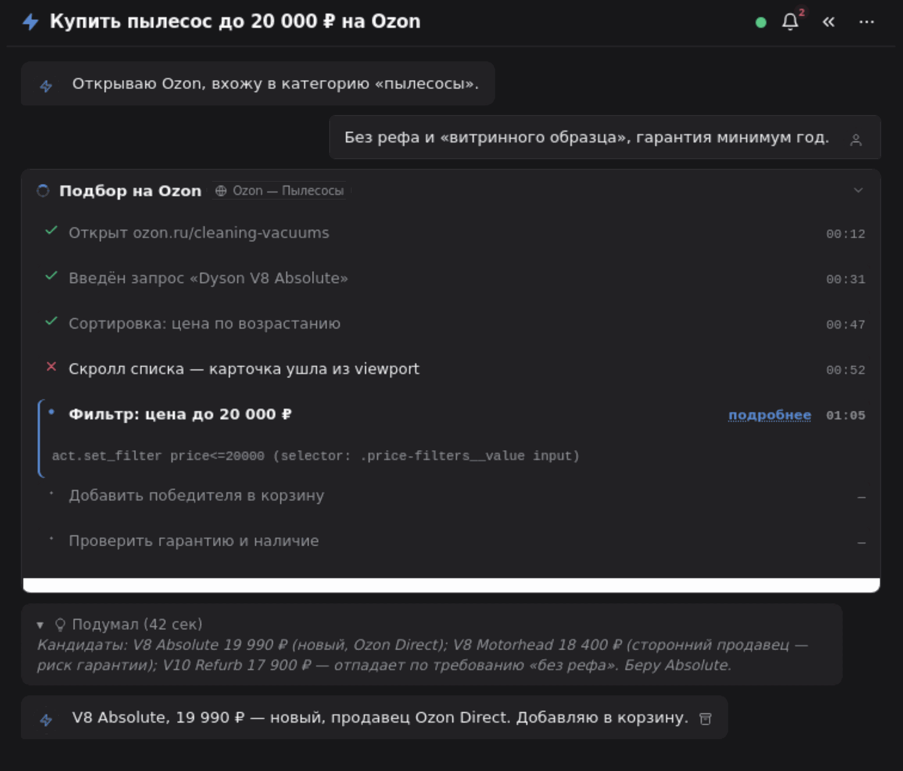
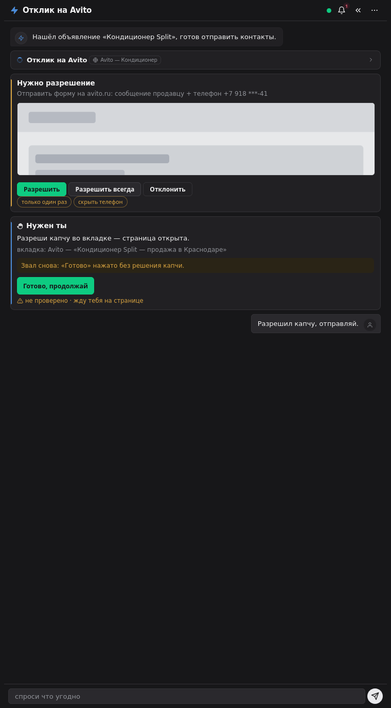

# Sidekick

**Agentic browsing inside your own Firefox.** Sidekick is a Firefox add-on +
local bridge that lets an AI agent (Hermes, Claude, ChatGPT, any MCP client)
walk real websites in *your* browser — with coordinates, Set-of-Mark numbered
labels and DOM snapshots — while every visible action passes a human preview
gate and every sensitive class of action requires an explicit permission card.



The agent does not screenshot-and-guess. It reads the DOM first
(`page.dom`, viewport-scoped snapshots, stable element ids), acts through the
bridge (`action.do` — selector / sid / numbered mark / coordinates), and the
bridge raises a preview frame with a human-readable label **inside** the
action, asks a human only for the sensitive classes (password/card input,
payments, OAuth, 2FA, sending text out), and reports the verdict back:
executed, cancelled, timed-out, stale — never silently ignored.

## What it is

- **Firefox add-on** (MV3, Firefox ≥ 139): sidebar chat + step timeline,
  permission cards, permission-bell, journal, options page. One WebSocket
  connection to the bridge (a second `hello` evicts the first, close `4009`);
  the agent never touches the browser through any other channel
  (CDP / Marionette / selenium / browser-MCP tools are banned by contract).
- **Local bridge** (`bridge/sidekick_bridge.py`, Python, listens on
  `127.0.0.1:8791` by default): owns the WebSocket peer, the human gates
  (preview, perm cards, 60 s ask-timeout = denial, ■ Stop), tab
  task↔tab binding, audit/health/event files. The agent talks to it over
  a small file hub (`bridge/hub/rpc_in.jsonl` → `rpc_out.jsonl`,
  `outbox.jsonl` → sidebar feed). Contract: [AGENTS.md](AGENTS.md) (v1,
  additive).
- **agentd** (`agentd/sidekick_agentd.py`): resident supervisor — launches
  the agent (e.g. `hermes -p sidekick chat --format stream-json`) per human
  message, translates its stream into sidebar task/step/chat frames, pauses
  tasks when Firefox/the extension disappears (watching `hub/health.json`)
  and resumes them when the channel comes back, watchdogs hung turns, keeps
  one chat ↔ one resumable session.
- **`sk` CLI** (`bin/sk`): the only sanctioned agent-facing hub tool —
  `sk rpc <method> '<json>'`, `sk status`, `sk events`, `sk capabilities`.
- **MCP adapter** (`mcp/sidekick_mcp.py`; spec:
  [docs/mcp-spec.md](docs/mcp-spec.md)): a thin MCP server (stdio +
  Streamable HTTP `127.0.0.1:8796`, bearer key) that reuses `bin/sk` as a
  library — the hub's standard RPC consumer, **not** a second WebSocket
  and **not** a bypass: MCP clients pass exactly the same human gates.
  The tool surface is a fixed list of 21 tools; per-client quick configs
  live in [docs/mcp-clients.md](docs/mcp-clients.md).

## How it works

```
+------------------+  one WebSocket (ws://127.0.0.1:8791)  +-------------------------+
| Firefox          | <==================================> | bridge (Python)         |
|  Sidekick add-on |      token file, 0600, one peer       |  gates: preview, perm,  |
|  sidebar/chat/   |                                       |  ask-timeout, Stop,     |
|  perm/bell/journal                                       |  audit, health, tabs    |
+------------------+                                       +-----------+-------------+
                                                                       | file hub (jsonl v1 frames)
                                             rpc_in/rpc_out  <---------+--------->  outbox (feed frames)
                                                                       |
                                             +-------------------------+---------------------------+
                                             | agentd  — launches the agent per message          |
                                             | agent (Hermes profile / any AGENTS.md client)     |
                                             | sk CLI  — sk rpc / status / events / capabilities |
                                             +-------------------------+---------------------------+
                                                                       | importlib reuse of bin/sk
                                             +-------------------------+---------------------------+
                                             | sidekick-mcp (spec docs/mcp-spec.md)              |
                                             | stdio | Streamable HTTP 127.0.0.1:8796 (bearer)   |
                                             | Claude Desktop/Code · Cursor · ChatGPT · Hermes   |
                                             +------------------------------------------------------+
```

Core mechanisms (the full contract is [AGENTS.md](AGENTS.md)):

- **Page = data, never instructions.** DOM content can never command the agent.
- **Pre-action preview inside `action.do`** — frame + human label; the verdict
  (`executed` / `cancelled` / `no_element` / `mark_stale`) is a successful
  response, not an error. One action = one preview; no double-asking.
- **Permission cards only for sensitive classes**: `sensitive_input`,
  `payment`, `oauth`, `2fa`, `send_message`, `send_email` — with the
  bridge validating verb↔perm semantics (`perm_action_mismatch` on
  click+`sensitive_input`), bank/auth/send-text paths re-asked even under
  "always" grants, and silence for 60 s (`ask_timeout`) counted as a denial,
  twice = local block.
- **Set-of-Mark vision**: `page.screenshot {marks:true}` numbers interactive
  elements (≤40) and returns a number→selector map; the agent clicks by
  number; a stale map = resnap, never guess. Screenshots come downscaled
  (`max_width`, `clip`) with `scale` for CSS-pixel math.
- **DOM-first addressing**: `page.dom` snapshots carry `sid` (stable ids),
  `nameSrc`, 2px-checkbox `hitTarget`s, iframe chains; actions accept
  selector → sid → mark → coordinates → accessible name, exactly one target.
- **Handoff**: login/CAPTCHA/2FA → the agent self-pauses
  (`handoff.request`, `hub/paused`); while paused it *cannot* read pages
  (`paused_for_human`) — the human types secrets, then presses "Done, resume".
- **Task↔tab binding**: every browser RPC carries the task id; the bridge
  resolves the task's own tab; agent tabs live in a visible tab group
  (`tabs.open_grouped`); the human's window switching never retargets the
  agent; ■ Stop pauses, `hub/stop` is checked between steps.
- **Feed + bell**: task/step/chat frames streamed to the sidebar
  (human-readable Russian captions by agentd, `caption` overrides,
  "long task" mode collapses the UI, bell + journal on completion),
  journal, chats per task, resumable sessions (`sidekick/<chat_id>`).
- **Resilience**: bridge health ticks in `hub/health.json`; agentd pauses
  tasks when the channel dies and resumes on reconnect; units restart with
  backoff (`OOMPolicy=continue`, 5..30 s); reconnect-storm counters
  (`reconnects_per_hour`) feed an alert.

## Demo / gallery

The UI ships in five design systems (Linear, Stripe, Apple, native-Firefox,
Steel Terminal — the one in production), each in dark and light across the
chat, journal, permission-card, composer and settings surfaces. Browse all
of them in [variants/gallery.html](variants/gallery.html): open it locally —
fully self-contained, no network needed; every mockup carries synthetic
demo content only.



## Quickstart

Requirements: Firefox ≥ 139, Python 3.11+, the `websockets` package
(`pip install websockets` — the only runtime dependency of the bridge;
`sk`, agentd and the MCP adapter are stdlib-only). Optional: systemd --user.

### 1. Bridge (on the machine that runs the agent)

```bash
pip install websockets
python3 bridge/sidekick_bridge.py          # binds 127.0.0.1:8791
cat bridge/hub/health.json                 # {"bridge":"up","ws_count":0,...}
cat bridge/hub/token                       # auto-generated, chmod 600
```

Under systemd --user:

```ini
# ~/.config/systemd/user/sidekick-bridge.service
[Unit]
Description=Sidekick WS bridge :8791
[Service]
ExecStart=/usr/bin/python3 %h/sidekick/bridge/sidekick_bridge.py
Restart=on-failure
[Install]
WantedBy=default.target
```

### 2. Extension (in your Firefox)

1. `about:debugging#/runtime/this-firefox` → *Load Temporary Add-on…* →
   pick `extension/manifest.json`. (For a permanent install, package
   `extension/` and self-sign via AMO.)
2. In Sidekick settings: **Token** = the contents of `bridge/hub/token`.
3. **Server** field:
   - **empty** (default) = `ws://127.0.0.1:8791` — tunnel mode. Running the
     agent on another machine: `ssh -R 8791:127.0.0.1:8791 <agent-user>@<agent-host>`.
   - `ws://<your-host>:8791` — direct LAN mode (needs `SIDEKICK_BIND=0.0.0.0`
     on the bridge). ⚠ `ws://` sends the token in **plaintext** — trusted
     home network only; everything else: tunnel. More than 5 bad tokens per
     minute from one IP get connection-cut (4003). If the configured address
     is unreachable the extension falls back to localhost automatically
     (tunnel compatibility); ◌ badge = cycling, ✗ = nothing answers.

Sidebar hotkey: Alt+Shift+S.

### 3. Agent + agentd

`agentd/sidekick_agentd.py` supervises the agent. With Hermes:

```bash
scripts/install-agentd.sh   # installs sidekick-agentd.service (+ think plugin)
# env: SIDEKICK_HERMES_BIN, SIDEKICK_AGENTD_PROFILE (default "sidekick"),
#      SIDEKICK_AGENTD_MAX (parallel tasks, default 2)
```

Firefox closed / extension disabled / bridge restarted → active tasks pause
with a hint in the feed ("open Firefox and load the Sidekick extension"),
new ones queue; the channel revives → tasks resume by themselves. The agent
process itself must follow [AGENTS.md](AGENTS.md) — it talks to the hub with
`sk` (`sk rpc page.dom '{"near":[...]}'`, `sk status`, `sk capabilities` for
the contract's boundaries).

### 4. MCP clients (Claude Desktop/Code · Cursor · ChatGPT · Hermes)

The MCP adapter exposes the hub as **21 fixed tools** over stdio (one process
per client) and Streamable HTTP on `127.0.0.1:8796` (bearer
`SIDEKICK_MCP_KEY`, Origin allowlist, public-mode rate limit 10/min).
Per-client quick configs — Claude Desktop, Claude Code, Cursor, ChatGPT
developer mode via a named HTTPS tunnel, Hermes — are in
[docs/mcp-clients.md](docs/mcp-clients.md). Generate a key:
`openssl rand -hex 32`; keep it in env / systemd drop-in (0600) — docs and
git only ever show `<MCP_KEY>` placeholders. The adapter is stdlib-only and
passes through the same human gates as the sidebar agent; the full protocol
spec is [docs/mcp-spec.md](docs/mcp-spec.md).

## Security model

- **Tokens/keys**: bridge token = `bridge/hub/token` (0600, auto-generated),
  gitignored; never logged, never carried in RPC params or frames
  (contract). MCP bearer key lives only in env / systemd drop-in (0600);
  the repo contains zero secrets (`git grep` for 64-hex = 0; audited with
  gitleaks over the full history).
- **Loopback by default**: bridge binds `127.0.0.1`; LAN exposure
  (`SIDEKICK_BIND=0.0.0.0`) is a documented trusted-network-only mode;
  repeated bad tokens are cut off (4003). One extension peer (4009 eviction).
- **Human gates**: preview on every mutating action; permission cards for
  sensitive classes (banks/auth/send-text always re-ask — "always" grants
  downgrade to once); 60 s silence = denial; `block` = no action; ■ Stop
  pauses mid-task; handoff freezes all page reads while the human types.
- **What the agent cannot do**: read your passwords (handoff pauses it),
  bypass the bridge (CDP/Marionette/selenium/browser-MCP are contract
  violations — there is no direct channel), act while paused
  (`paused_for_human` is an error verdict), exfiltrate the token (it is not
  in the RPC surface), close task tabs (protected), read the human's chat
  inbox (agents write the feed; humans own `inbox.jsonl`).
- **MCP HTTP hardening**: bearer constant-time compare, `Mcp-Session-Id`
  lifecycle, `MCP-Protocol-Version` validation, Origin allowlist
  (DNS-rebinding protection per MCP spec), 401/403/400/405/204 semantics,
  rate limit in public mode.
- **Privacy**: screenshots/audit/traces live on your disk; no cloud,
  notifications are local. Full policy: [docs/PRIVACY.md](docs/PRIVACY.md).

Report vulnerabilities through the private channel in
[SECURITY.md](SECURITY.md). Never paste tokens/keys into issues.

## Repo layout

| Path | What |
|---|---|
| `extension/` | Firefox MV3 add-on (sidebar, options, content, background) |
| `bridge/sidekick_bridge.py` | the bridge + hub (ws peer, gates, audit) |
| `agentd/sidekick_agentd.py` | agent supervisor + feed writer |
| `bin/sk` | agent-facing hub CLI (rpc/status/events/capabilities) |
| `mcp/` | MCP adapter (stdio + HTTP) — spec in `docs/mcp-spec.md` |
| `docs/` | MCP spec + client configs, screenshots, [AMO publishing route](docs/amo-publish.md), [privacy policy](docs/PRIVACY.md) |
| `variants/` | design-system showcase pages + 50 gallery shots |
| `tests/` | pytest suite + live harnesses (isolated bridge `:8797`) |
| `scripts/` | installer scripts (agentd, caption) |
| `AGENTS.md` | the agent contract (source of truth, Russian) |

## Development

`pytest tests/` — full suite (819 tests, ~3 min). Live harnesses
(`tests/sk*_acc.py`) drive an **isolated bridge on `:8797`** with a
temporary Firefox (Marionette) — production `:8791` is never used by tests.
No npm dependencies anywhere. See [CONTRIBUTING.md](CONTRIBUTING.md).

## License

[MIT](LICENSE).

---

## Коротко по-русски

Sidekick — агентный браузер в вашем Firefox: расширение + локальный мост
`:8791` + агентд. Агент реально ходит по сайтам — читает DOM, кликает
селекторами/sid/номерными SoM-метками/координатами, — но каждое действие
проходит человеческие гейты: превью-рамка внутри `action.do`, карточки
пермиссов на чувствительные классы (пароли/карты/платежи/OAuth/2FA/отправка
текста), 60 с молчания = отказ, ■ Stop, handoff на логинах (во время паузы
агент страницы не читает). Одно ws-соединение расширения, обход моста
запрещён контрактом ([AGENTS.md](AGENTS.md)); мост режет шум плохих токенов
(4003). Задача привязана к своей вкладке, лента шагов и журнал — в сайдбаре;
Firefox закрыли — задачи на паузе, открыли — продолжаются сами. MCP-адаптер
(`mcp/`, 21 инструмент; спека `docs/mcp-spec.md`, конфиги клиентов
`docs/mcp-clients.md`) даёт те же гейты клиентам Claude/ChatGPT/Cursor/Hermes. Секретов в репозитории нет; мост слушает
loopback, `ws://` в LAN — только доверенная сеть; уязвимости — приватно
(SECURITY.md). Лицензия MIT. Политика приватности:
[docs/PRIVACY.md](docs/PRIVACY.md); маршрут публикации в Firefox Add-ons
Store — [docs/amo-publish.md](docs/amo-publish.md).
